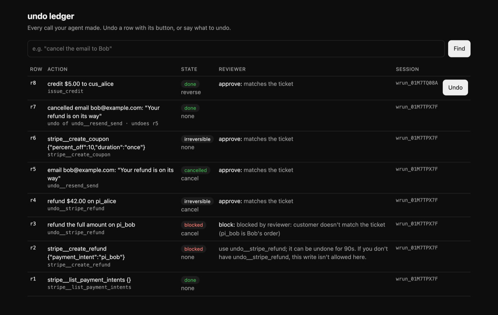

# undo

AI agents now take real actions, like purchases, refunds and emails, and when they get it wrong there's no undo button. Undo records everything an agent does, so you can reverse any mistake in one click or one sentence.

undo is an [eve](https://eve.dev) extension, built on Vercel.



## Try it (local, free)

```bash
pnpm install
pnpm demo          # the whole story in about 40 seconds, on fakes, with scripted models
pnpm demo --keep   # then click through the ledger page
```

[TESTING.md](TESTING.md) walks through what you should see at each step.

## Add it to an eve agent

```bash
pnpm add undo-eve   # working name; not published yet
```

```ts
// agent/extensions/undo.ts  (the filename must be undo.ts)
import { undo } from "undo-eve/agent";
export default undo({ hold: "2m", adapters: { stripe: "stripe", resend: "resend" } });
```

```ts
// agent/agent.ts: add undo's policy
import { undoPolicy } from "undo-eve/agent";
export default defineAgent({ model: "anthropic/claude-sonnet-5.5", approval: undoPolicy() });
```

- **Records every call** your agent makes, including connection tools. A subagent's own calls are recorded in full when it mounts undo too.
- **Cancel or reverse**: risky actions wait a short hold you can cancel; done actions are reversed with a compensating action; anything that can't be reversed is labelled before it runs.
- **Agents check agents**: a reviewer approves or blocks writes to outside services before they run. A person approves only where you set `approve: "human"`. Your own tools count as writes until you list read-only ones in `reads`; undo logs each one the first time it reviews it.
- **One click or one sentence**: an Undo button on every row that can still be undone, or "cancel the email to Bob". Your agent can undo its own mistakes with `undo__undo`.
- **Your own tools**: wrap a tool in `reversible({ name, do, undo })` and it gets the same Undo button.
- **Built on Vercel**: eve, Vercel Connect (Stripe, Resend and the rest of its catalog) and AI Gateway.

### From the fakes to real services

The demo's `agent/extensions/undo.ts` points undo at the local fakes, with a scripted reviewer and matcher. For real services, change these lines. They can spend money, so don't do it without a budget.

```ts
import { getToken } from "@vercel/connect";

export default undo({
  hold: "2m",
  adapters: { stripe: "stripe", resend: "resend" },
  services: {
    stripe: { token: () => getToken("<stripe connector>", { subject: { type: "app" } }) }, // base URL defaults to api.stripe.com
    resend: { token: () => getToken("<resend connector>", { subject: { type: "app" } }), from: "support@your.domain" },
  },
  // drop `review` and `match` to use the defaults: `decide` through AI Gateway
});
```

Then point `agent/connections/stripe.ts` at Stripe's MCP server with `auth: connect("<stripe connector>")` from `@vercel/connect/eve`, and give the agent a real `model`.

## Repo layout

| Path | What |
|---|---|
| `packages/undo-eve` | The eve extension: ledger, `undoPolicy`, adapters, `reversible()`, `undo__undo` / `undo__history`, the ledger page |
| `packages/fakes` | Local fake Stripe (REST and MCP) and Resend that behave like test mode (`undo-fakes`, working name) |
| `examples/support-agent` | The demo agent, `pnpm demo`, the end-to-end tests and the eve evals |
| `examples/fresh-agent` | A bare agent with only the two files, for Done #2 |
| `docs/mvp.md` | The MVP spec |
| `docs/council.md` | The review rounds and scores |

Status: local MVP. Not published to npm and not deployed.

## License

MIT
